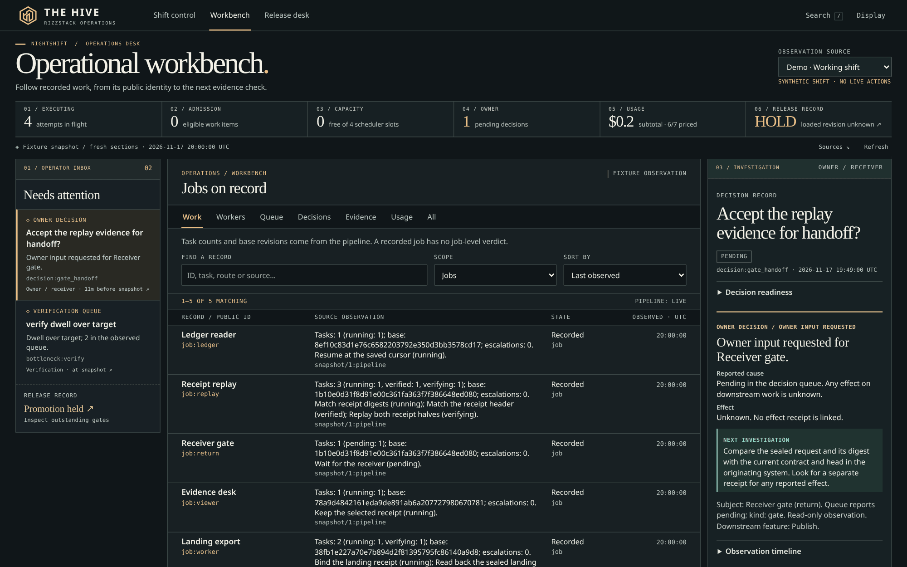
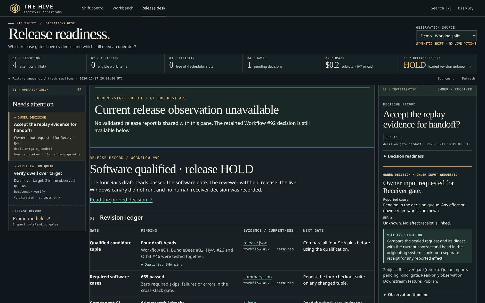

<p align="center"></p>

# rizzstack

**A software development factory for people who want to delegate the coding and still know exactly what they’re shipping.**

Give a team of coding agents a feature, a budget, and a definition of done. rizzstack splits the work into bounded tasks, gives each worker (a *bee*) a set of files it may change, and checks the returned patches against the tests agreed on before coding began. You get a report that ties each requirement to a Git revision and its evidence. You decide whether to ship.

[Explore The Hive](#the-hive) · [Try the offline demo](#try-the-offline-demo) · [Meet the four projects](#meet-the-four-projects) · [Build log](NEWS.md)

## The Hive

The Hive is Orbit Desktop’s read-only console for supervising a shift. Start with **Needs attention**: select an owner question to see what decision is pending, which job it concerns, and when its source was last read. To investigate running work, select an attempt and follow its public ID into the Rails activity ledger.


*A simulated shift, captured in Chromium. The command bar counts 14 attempts in flight and one pending owner decision. The inspector shows the recorded canary question; opening it does not approve it.*

**Why is work still queued if a draft PR already exists?** In the example below, the workbench compares the draft with a frozen contract. Three criteria have evidence; `AC-004` does not. The feature stays queued so the coordinator can reconcile what remains.


Both screenshots come from the [Hive review candidate](https://github.com/mojomast/orbitdesktop/pull/48), using fixture data rather than a production workspace. [Run the same shift locally](https://github.com/mojomast/orbitdesktop/blob/3e0f0838fd65810bbb1d477b1422b3bc1082c816/extensions/rizzstack-hive/README.md) without credentials, or read [what the host can share with the console](https://github.com/mojomast/orbitdesktop/blob/3e0f0838fd65810bbb1d477b1422b3bc1082c816/docs/HIVE_OPERATIONS.md).

More of the same local demo, captured headless in Chromium from the Hive's static app (`orbitdesktop` `main` at `d3a115c`, fixture data, no live host):


*Incident replay (`?demo=replay`). Step through 35 recorded origin events from the first failure to the combined-tree pass; the investigation panel names the verifier record, its Git revision and contract digest.*



*The operational workbench (`?demo=shift`, **Workbench**). Work, Workers, Queue, Decisions, Evidence and Usage index the same projection. A pending owner decision is shown, never approved.*



*The release desk. Software qualification and the release decision are separate records: here the software passed and the release is held for the Windows canary and a human receiver.*

The [Mission Control review](docs/hive-mission-control.md) adds selected Rails history and owner-enrolled coordinator reports. Its native docket example covers **two of three leased files**; the three-of-four **criterion** rehearsal above is a separate observation.

## Try the offline demo

<p align="center"></p>

The fastest way to understand rizzstack is to watch it **reject a patch that makes a test pass by changing the test**. You only need Git and Python 3. After cloning, the demo runs offline with scripted workers and a scripted reviewer; it needs no model account, API key, or running services.

```sh
git clone --depth 1 https://github.com/mojomast/workflow.git
cd workflow
python3 reference/run_demo.py --out demo-run
```

Two workers change pricing and receipt labels in a toy shop. Their patches pass verification and the combined test suite. A third worker touches a file outside its assignment (`scope_violation`); a fourth weakens an approved test (`tests_tampered`). Neither rejected patch reaches integration.


*A real run of the commands above, followed by `acdd-lint` checking every contract and signed evidence record it produced.*

Open **`demo-run/ACCEPTANCE.md`** to see the verdict for each requirement. Follow a reference into `demo-run/evidence/` to compare the failing test on the baseline (**RED**) with the passing test on the patch (**GREEN**). The [demo guide](https://github.com/mojomast/workflow/tree/main/reference) explains the records and how the teaching setup differs from production verification.


*`demo-run/ACCEPTANCE.md` from the same run (W1 and W4 sections). `not run` is never counted as passed.*


*The RED and GREEN records behind that report, and the two rejections, read with `jq`.*

## What you get from a run

| Question you’d ask at code review | What rizzstack gives you |
|---|---|
| **What was this worker allowed to do?** | A frozen contract names the acceptance criteria. A signed file lease binds the assignment to a revision and a set of paths. A worker cannot expand its own assignment. |
| **Would the change pass outside the worker’s environment?** | BundleBees applies the patch in a fresh checkout, checks its scope and approved tests, runs verification in a sandbox, and scans for secrets. Patches that pass individually still have to pass the combined suite. |
| **What happens if a worker stops halfway through?** | The coordinator records attempts and reconciles them after interruption. A retry is bounded by the job’s authorization; an ambiguous result can be held for a decision instead of silently starting another attempt. |
| **What did the attempt cost?** | Usage records distinguish a reported zero from missing data. If a worker reports tokens but there’s no applicable price, you keep the token count and the cost stays unknown. |
| **What am I being asked to accept?** | A [`RETURN` manifest](https://github.com/mojomast/workflow/blob/main/docs/26-return-manifest.md) links each criterion to its checks and records what failed or never ran. A worker finishing, a verifier passing a patch, and an owner accepting a feature are three separate events. |

## Meet the four projects

<p align="center"></p>

This repository is the map. Each component has its own implementation, setup instructions, and release history. Start with the part you need.

**Agents and contributors:** the [code map](codemap/README.md) covers every repo at pinned commits: a one-screen overview, a page per repo, cross-repo contracts, change recipes, invariants, and a regenerable symbol index (`python3 scripts/codemap/build.py`). Agents start at [AGENTS.md](AGENTS.md).

| Project | Role | Start here if you want to… |
|---|---|---|
| [**Workflow**](https://github.com/mojomast/workflow) | Defines the contracts, tests, evidence formats, and handoffs that the other projects share. | [Write a feature contract](https://github.com/mojomast/workflow/blob/main/templates/CONTRACT.md) or use the method with your own team. |
| [**BundleBees**](https://github.com/mojomast/bundlebees) | The coordinator. Its Hermes plugin assigns work, tracks leases, verifies patches, and integrates accepted changes. | [Run a coordinator or adapt a worker backend](https://github.com/mojomast/bundlebees/blob/main/docs/ADAPTERS.md). |
| [**Hyvv**](https://github.com/mojomast/hyvv) | The worker host. It runs agent sandboxes, keeps provider keys on the host, and reports attempts and artifacts through a versioned API. | [Connect a machine that does the work](https://github.com/mojomast/hyvv/tree/main/contract/v1). |
| [**Orbit Desktop**](https://github.com/mojomast/orbitdesktop) | The operator’s workspace. Terminals, agent conversations, project tools, and the Observatory share a browser desktop. | [Start Orbit locally](https://github.com/mojomast/orbitdesktop/blob/main/docs/QUICKSTART.md) and inspect work as it happens. |

The contracts are the connection points. A coordinator can speak Hyvv’s `/v1` API without running Orbit; a team can adopt Workflow’s contracts without running any workers. To integrate another tool, start with the [protocol map](docs/protocol.md) and [agent extension guide](docs/adding-an-agent.md).

## How it was built

[Kyle Durepos](https://github.com/mojomast) developed rizzstack while working with agents on games, creative tools, and Hermes plugins. The [project history](https://github.com/mojomast/workflow/blob/main/docs/07-projects.md) traces those builds. Kyle directed the work; coordinator agents broke it into briefs, and coding agents worked in disposable sandboxes. Some of the most useful parts of the stack came from runs that went wrong.

**A chat window made a poor scheduler.** During the Jackpot Syndicate build, workers could finish while the coordinator waited for Kyle to say “what’s next?” The team reconstructed six pauses from the transcript. They found 22 file leases but no campaign-level job to resume. That distinction shaped the [campaign continuity design](https://github.com/mojomast/workflow/blob/main/docs/31-campaign-continuity.md): persist the authorized objective and the completed steps so the next coordinator can recover them without reading the chat.

**The factory had to grade its own work by the same rules.** Four bees built `acdd-lint`, the tool that checks rizzstack’s contracts and test evidence. All **35 linter tests passed**. The sandboxed integration step failed, though, so the run recorded **zero accepted changes and two rejected integration waves**. The [build record](https://github.com/mojomast/workflow/tree/main/evidence/2026-11-12-acdd-lint-dogfood) includes the contracts, commits, test results, and the failure. A reviewer can reconstruct why the tool worked *and* why that run didn’t earn acceptance.

## What’s available now

*Checked against each repository’s `main`, its CHANGELOG and `workflow/plans/backlog.json` on 24 November 2026 (America/Toronto).*

- **Runnable today:** the offline demo above and the [cold-start acceptance exercise](https://github.com/mojomast/workflow/tree/main/acceptance), which takes the next step into the real BundleBees dispatch, verification, and integration path. For live installations, use each component’s release and setup notes.
- **Rails, the activity ledger: code landed in all four repos.** [Workflow #91](https://github.com/mojomast/workflow/pull/91), [Hyvv #26](https://github.com/mojomast/hyvv/pull/26), [Orbit #46](https://github.com/mojomast/orbitdesktop/pull/46) and the [BundleBees coordinator changes (#82)](https://github.com/mojomast/bundlebees/pull/82) are merged (#82 on 17 November). All 22 `RAILS-*` slices in the backlog (R00–R18, including R17A–D) are `landed`, backed by the four-repository acceptance run [`mojomast/workflow#44227465033`](https://github.com/mojomast/workflow/actions/runs/44227465033). In a local acceptance run, the importer resumed after a worker restart without duplicating events, and Chromium and the CLI selected the same original event ID. The Rails **release** is still on hold: the [release decision](https://github.com/mojomast/workflow/blob/main/evidence/rails-rc/release/DECISION.md) separates the qualified source revisions from the open worker-assignment binding and a live Windows canary. That record predates the merges and still calls the attempt index opt-in; [BundleBees #84](https://github.com/mojomast/bundlebees/pull/84) has since made it the default for new ledgers. `rails_enabled` stays off.
- **M2 canary: one RETURN accepted.** The backlog marks `M2-CANARY-RUN` `landed` on the accepted canary RETURN (digest `0515b019`) and the attributed re-dispatch, with an acceptance report for AC-001 to AC-005 and a signed reviewer attestation ([Workflow #94](https://github.com/mojomast/workflow/pull/94)). **Whether it ran on the native Windows worker is unconfirmed:** the backlog note calls it a Windows canary, but no committed record names the worker host or its platform, and the [Windows canary assessment](https://github.com/mojomast/workflow/blob/main/evidence/rails-rc/windows-canary.md) written earlier the same day records the native Windows run as blocked before live preflight.
- **Also on `main` since 17 November:** risk tiers enforced at dispatch ([BundleBees #247](https://github.com/mojomast/bundlebees/pull/247)), slop-lint as a blocking ratchet in Workflow, Hyvv, BundleBees and Orbit, the memory vault service with `MEMORY_ENABLED` still off ([Workflow #98](https://github.com/mojomast/workflow/pull/98)), the live observability snapshot for Hermes chat cards ([orbit-control-plane #4](https://github.com/mojomast/orbit-control-plane/pull/4)), [uirizz v0.1.0](https://github.com/mojomast/uirizz/releases/tag/v0.1.0) and the [code map](codemap/README.md). The day-by-day record is in [NEWS.md](NEWS.md).
- **Released tuple:** workflow v0.1.0, hyvv v0.1.18, bundlebees v0.2.0 and uirizz v0.1.0 are tagged; orbitdesktop 0.4.0 awaits its tag. [COMPAT.md](COMPAT.md) lists the exact commits and the pins bundlebees ships with them, and [docs/RELEASING.md](docs/RELEASING.md) the tag order and the immutable-release steps.
- **For maintainers:** [NEWS.md](NEWS.md) keeps the dated operational history. The [coordinator playbook](https://github.com/mojomast/workflow/blob/main/docs/19-coordinator-playbook.md) explains authorization, review, and the human decisions required for merge, release, and deployment. [docs/deploy-hygiene.md](docs/deploy-hygiene.md) covers the deploy hosts: every deploy directory is a detached checkout of a merged commit, development happens in worktrees, and a branch, a dirty tree or a running SHA behind the checkout raises a watchdog finding.
