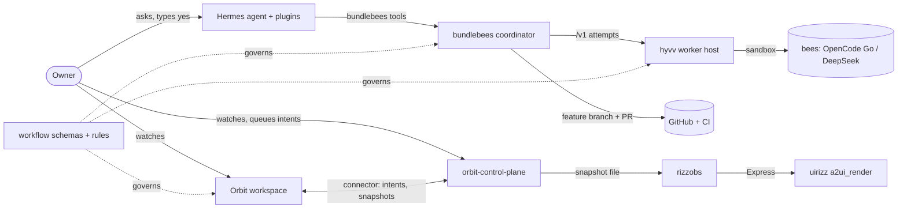

# Architecture (C4-style views + data flows)

Generic deployment names only: **owner PC** (Windows + Docker Desktop, runs hyvv), **box** (the coordinator's Linux machine), **Orbit host**, **Hermes host** (runs Hermes with uirizz/rizzobs), **public app host**. Real hostnames, addresses and ports live in the private host runbook.

## Context



## Containers

| Container | Repo | Runtime | Holds secrets? |
|---|---|---|---|
| hyvv launcher | hyvv | Python, on owner PC / SSH host, loopback or private bind | provider keys, host token (never returned) |
| bundlebees plugin + CLI | bundlebees | inside Hermes; CLI on the box | launcher token via Hermes `get_secret` |
| Orbit server + UI | orbitdesktop | Node 22 + TS UI, Docker on Orbit host | Orbit keys, launcher-scoped token |
| control plane | orbit-control-plane | Node 22, SQLite, systemd | its own bearer tokens only |
| connector sidecar | orbit-control-plane | Node on Orbit host | Orbit app keys (scrubbed before push) |
| obs collector | orbit-control-plane | Node script on a timer | Orbit key file, `gh` auth |
| rizzobs, uirizz | orbit-control-plane, uirizz | Hermes plugins on Hermes host | none |
| Observatory collector | workflow | Python service (contrib) | reads local state |

## Flow 1: a leased change from ask to merge

```mermaid
sequenceDiagram
  participant O as Owner
  participant C as Coordinator (Hermes + bundlebees)
  participant H as hyvv
  participant V as verify (bwrap, no net)
  participant G as GitHub
  O->>C: outcome
  C->>C: acdd/1 contract frozen by hash; brief (assigned_files, source_rev, risk tier)
  C->>C: _dispatch gates: brief_invalid / risk_tier_below_floor / contract_missing / research gate
  C->>H: POST /v1/attempts
  H-->>C: events, result, bee-landed/1
  C->>V: apply patch at source_rev; scope + test fingerprints; RED/GREEN; full suite; gitleaks
  V-->>C: tdd-evidence/1 or rejection (scope_violation, tests_tampered, ...)
  C->>G: feature branch + PR (gitleaks before push)
  G-->>C: CI (slop-lint, tests, secret scan)
  C->>G: merge when green + independent review (heartbeat stream)
  O-->>C: typed yes required for tag / release / deploy
```

## Flow 2: observability

Orbit `/api/local-workers` + attempt result files + `gh` (read-only) + host stats → `orbit-control-plane/scripts/obs-snapshot.mjs` → redacted `rizzstack.observability/1` JSON (0600, atomic) → `rizz_observability(view)` → uirizz card, updated in place. A parallel, older path feeds the Observatory: `workflow/contrib/rizzstack-observability/collector.py` → `rizzstack.observability/snapshot/1` → Observatory apps.

## Flow 3: approvals

- uirizz: click → `pending_confirmation` → user types `yes <code>` → single-use approval (600 s) → exactly one bound tool call → hash-chained audit entry.
- bundlebees: `pre_tool_call` hook asks Hermes approval before cancel/review; job authorization and one-time owner approval in `bundlebees/bundlebees_plugin/approval.py`.
- orbit-control-plane: auto-approved sandbox events are labeled and get no decision buttons; human decisions become intents.

## Flow 4: Rails activity ledger

hyvv recorder (`hyvv/rails_emitter.py`) → replication API (`hyvv/rails_export.py`) → bundlebees importer (`bundlebees/contrib/rizzstack_rails`) → hash-chained SQLite ledger → Orbit inspector shows the same event ids (`orbitdesktop/server/rails-proxy.mjs`).
