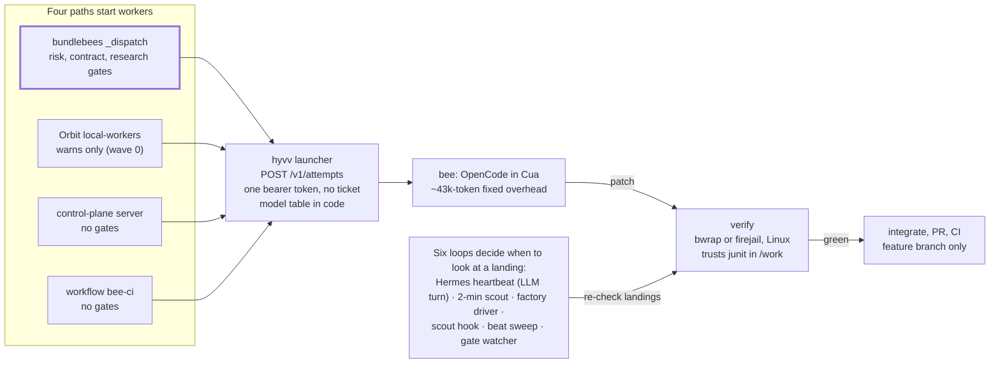

# rizzstack: next-level review

Nov 24, 2026 · a review of `main` across the seven repos (SHAs under [Method, limits and sources](#method-limits-and-sources))

rizzstack's core method is ahead of most agent tooling: contracts frozen by hash, file leases, sandboxed RED/GREEN, and rejecting patches that tamper with tests. What holds it back is around that core. The safety gates sit in one of four code paths that start workers. The worker contract exists in three diverging copies. Providers, harnesses and sandboxes are hard-coded. Durable-queue plumbing has been re-implemented dozens of times. Five moves fix most of it, in this order.

## The five moves

1. **Enforce the gates where every dispatch must pass: the worker host.** Four code paths create attempts: bundlebees `client.py`, Orbit `server/local-workers.mjs`, orbit-control-plane `src/server.mjs` and workflow `contrib/bee-ci/dispatch.py`. Only bundlebees runs the risk, contract and research gates; Orbit only warns (wave 0). Have the coordinator sign a dispatch ticket (brief hash, lease, contract digest, risk tier, expiry). hyvv then refuses `POST /v1/attempts` without a valid one. This generalizes the worker-assignment binding the Rails release is already waiting on.
2. **One worker contract, owned by workflow.** There are three `brief.schema.json` files (bundlebees 140 lines, hyvv 85, Orbit's legacy launcher 21), and none lives in `workflow/schemas`. hyvv ignores what it doesn't render: `render_prompt` (`hyvv/launcher.py:1814`) drops `contract`, `tests`, `risk` and `findings`. Attempt states disagree: hyvv has 3 terminal states, Orbit 7, and bundlebees 9 different sets. Publish `rizzstack.brief/1` and `rizzstack.attempt/1` (one state enum) in workflow, and generate the Python and JS validators from them.
3. **Three adapter seams, each backed by a standard.**
   - **Harness:** ACP or headless JSON mode, covering OpenCode, Claude Code, Codex, Gemini CLI and Goose.
   - **Model:** an OpenAI-compatible gateway such as LiteLLM or Bifrost, with the model table as config instead of code.
   - **Sandbox:** an OCI container per attempt and per verify, built from the project's `devcontainer.json`, with bwrap (Linux) or Seatbelt (macOS) as the light fallback.

   Today `hyvv/launcher.py` hard-codes three provider URLs, 15 model entries and two harnesses (plus a no-model check runner). Verification runs only on Linux and uses the coordinator host's own toolchain.
4. **Collapse the plumbing into one event log and one small core library.**
   - **Loops:** at least six control loops overlap: the Hermes heartbeat (an LLM job), the 2-minute scout, the factory driver, the scout hook, the beat sweep and the gate watcher, plus board sync.
   - **Repeated helpers:** about 50 atomic writers, 23 `flock` sites, 13 canonical-JSON hashers, 5 hash-chained logs and about 44 scrubbers, some of which disagree.
   - **The fix:** make Rails, which is already hash-chained and replicated, the single event log every loop reads. Vendor one `rizzstack-core` module (atomic write, lock, canonical JSON, scrub, time) everywhere.
5. **Measure cost per verified patch, then make the bee loop cheap.**
   - **Briefs:** give each bee the failing test output and the list of affected tests, not procedure. Research shows test context cuts regressions and procedural TDD instructions raise them.
   - **Retries:** a rate limit currently restarts the bee from zero. Resume instead.
   - **Overhead:** cut OpenCode's roughly 43k-token fixed overhead per run.
   - **Caching and routing:** order prompts so the provider caches the shared prefix, and run a cheap model first, escalating only when verification fails.

## How it works today

Every path ends at the same `POST /v1/attempts`, so that's where the gates belong (moves 1 and 2). The bottom box is the plumbing that move 4 collapses into one loop.

## Fix now: correctness and safety

Each row was re-read against the code on current `main` (Nov 24). Two agent claims came out weaker on checking and are listed under the table.

| # | Finding | Where | Severity | Fix |
| --- | --- | --- | --- | --- |
| 1 | Verify trusts files that the code under test can write. `junit.xml` and `collected.json` sit inside the sandbox's writable `/work`, and per-criterion TDD evidence is built from them. Patched code (a `conftest.py`, `atexit` hook or `os._exit(0)`) can rewrite them or force the exit code. | bundlebees `sandbox.py:1161-1162, 1269-1290`; `tdd.py` `parse_junit_cases` | High | Treat a green run as necessary, not sufficient. Add a static test-subversion scan of each patch (conftest, `sitecustomize`, `.pth`, pytest plugins, `os._exit`, `atexit`, patched assertions). Require the collected test ids to match the approved list exactly. Keep CI's independent re-run as the second gate. |
| 2 | No wall-clock limit unless the brief sets `budget.timeout_s`. A stuck bee holds a concurrency slot forever. | hyvv `launcher.py:1565-1570, 2332-2339` | High | Apply a host default timeout; refuse briefs with no budget. |
| 3 | A rate limit throws away the bee's work. `_backoff` drops `run_id` and `sandbox` and resets the cursor, so the retry starts a fresh run with the full prompt. | hyvv `launcher.py:2632-2668` | Medium (cost) | Resume the same sandbox and session with a short "continue" turn; restart only if the sandbox is gone. |
| 4 | Retried attempts leak sandboxes. Cleanup runs once per attempt id (`_cleaned_aids`), but backoff calls it before re-dispatching, so the retry's new sandbox is never torn down. | hyvv `launcher.py:1913, 2148-2152` | Medium | Key cleanup by sandbox id, not attempt id; add a test that counts teardowns across a retry. |
| 5 | Research-before-retry findings never reach the bee. The gate requires findings (`research_gate.py:668`), but `render_prompt` never prints them. | bundlebees `research_gate.py:668`; hyvv `launcher.py:1814-1821` | Medium | Render `findings` into the prompt; fixed for good by the single brief contract (move 2). |
| 6 | The lease-overlap check fails open. If reading live attempts raises, the list is treated as empty and dispatch goes ahead. | bundlebees `tools.py:684-697` | Medium | Refuse with `launcher_unreadable` when the overlap check can't run. |
| 7 | Contract checks are report-only on the live path, and only high tier forces a contract. | bundlebees `tools.py:73` (`CONTRACT_GATE_MODE = "report_only"`), `tools.py:616-625` | Medium (known) | Set a date to enforce; start by requiring contracts at medium tier. |
| 8 | The risk floor is thin. Four basenames are sensitive. Anything under `tests/` or `docs/`, and any `.md`, is low tier, including `tests/conftest.py`. | bundlebees `risk.py:20-22, 63-69` | Medium | Move the path policy to a data file (CODEOWNERS-style). Make test infrastructure (conftest, fixtures, CI config) high tier. |
| 9 | Git calls on the integration path have no timeout. | bundlebees `integrate_job.py:67-79` (and about 10 other sites) | Medium | One shared `git()` helper with a timeout (see the core library, move 4). |
| 10 | Control-plane sessions never expire server-side, and the control `POST` routes check identity but not role. | orbit-control-plane `src/auth.mjs:50-53`, `src/server.mjs:170-186` | Medium | Expire sessions at the cookie's 12 h. Restrict control routes to an operator role. |
| 11 | A test-only recovery adapter (`authorized`) that derives a superseding contract can be picked in production via the work item's adapter hint or a CLI flag. | bundlebees `agent_consumer.py:51, 898, 914-929` | Medium-low | Allow it only under an explicit test flag. |
| 12 | Preflight ignores the `require_contract` setting that real dispatch honours, so the two can disagree when it's on. | bundlebees `preflight.py:78` vs `tools.py:1219` | Low | Pass the setting through. |
| 13 | The bee-landed event has four identifiers that disagree, including the misspelled host `rizstack.dev`. | hyvv `launcher.py:211-213`; workflow `schemas/bee-landed.schema.json` | Low | Pick one type, one `$id`; fix the typo. |

Row 1 is about LLM reward hacking more than malice. Models are known to special-case tests, and a verifier that runs the patch can't fully defend against the patch. The scan and the exact-id match make it much harder to do by accident.

**Weaker on checking:** Orbit Collab's `sh -c` path does have an approval gate by default: `shell.write` is in the default approve policy (`server/collab.mjs:1270-1274, 1615`). The residual issue is the one its prompt already admits: approved commands run unsandboxed. And preflight only diverges from dispatch when the `require_contract` setting is on (row 12), not for every uncontracted brief.

## Token waste

The biggest costs are fixed overhead per bee run and unbounded tool results, not the briefs: a typical brief is a few hundred tokens. Sizes are characters ÷ 4. "Measured" means counted from the files; "repo" means the repo's own comment.

| Where tokens go | Size | Paid | Fix | Est. saving |
| --- | --- | --- | --- | --- |
| OpenCode's own system prompt and tools in every bee run | ~43k tokens (repo: `hyvv/launcher.py:56`) | Per bee run | Measure it, disable unused built-in tools, and compare a lean harness such as mini-swe-agent | 10-20k per run (est.) |
| Rate-limit retry restarts the run from scratch (Fix now #3) | Full prompt + all prior turns again | Per retry, up to 4 on Go; the free pool rotates through 9 models | Resume the session; cap model rotation | Up to 150k per affected attempt (est.) |
| `bundlebees_status op=attempts` returns every attempt, with no limit | 58,924 chars for 296 attempts, ~14.7k tokens (measured) | Per call | Default `limit=20`, a state filter, and a `detail` switch | ~14k per call |
| Orbit `orbit_workspace describe catalog=true` | 41,727 chars, ~10.4k tokens (measured) | Per discovering chat; stays in the transcript | Return op names; give one op's schema on request | ~8k per chat |
| Orbit inlines the whole `docs/AGENT_GUIDE.md` into every workspace-aware run (deliberately, per the comment at `server/workspace.mjs:158-161`) | 29,633 chars, ~7.4k tokens (measured) | Per run | Pass the path, as the Grok path already does | ~7k per run |
| `orbitdesktop/AGENTS.md` points bees at three long docs | 61,006 chars, ~15k tokens (measured) | Per Orbit bee that follows it | A short router of non-standard commands only | up to 12-15k per run |
| bundlebees operator skill makes three reference reads at dispatch | 20,033 chars (measured) | Per dispatch session | Load the verify table only at the verify step | ~2.8k per session |
| uirizz skill, recipes and Express reference persisted in the chat | ~4.1k tokens (measured) | Per card chat | Make SKILL.md an index | ~2-2.5k per chat |
| Per-turn injections: bundlebees system section; uirizz card hint (no TTL) and pending-approval notice (repeated for up to 600 s) | 150-750 chars each | Every turn | Drop the bundlebees section; announce the uirizz notices once | ~150-300 per turn |

Two more changes cost little and compound:

- **Cache-friendly prompts.** Put stable text first (harness prompt, rules, invariants) and the per-bee task last, with no timestamps or ids in the prefix. Warm the cache with one request before fanning out. Anthropic and OpenAI bill cache reads at about a tenth of the input price; DeepSeek caches automatically.
- **Hard budgets and early exit.** Token use on the same task can vary up to 30x between runs, and spending more doesn't reliably raise accuracy ([arXiv 2604.22750](https://arxiv.org/abs/2604.22750)). Cap tokens and tool calls per bee. Stop on repeated identical calls or an unchanged failing test after two patches.

Don't add repo overviews to briefs. An ETH Zurich study found context files don't generally improve task success and add over 20% to inference cost; they help only for non-standard practices ([arXiv 2602.11988](https://arxiv.org/abs/2602.11988)). The codemap slicer (`build.py --slice`) is worth wiring only for invariants and non-standard rules, under its 1.5k cap, and A/B tested.

## Unwired and duplicated code

About 6,000 lines of bundlebees have no production caller. The same small helpers have been rewritten dozens of times across the repos, and some copies disagree in ways that change digests.

**Unwired or half-wired**

| Item | Where | Size | Action |
| --- | --- | --- | --- |
| Nine modules with no production importer: `verify_workers` (marked NOT WIRED), `trial_harness`, `trial_simulated_driver`, `contract_gate`, `risk_policy` (report-only), `rework_metrics`, `rails_owner_bridge`, `hive_docket`, `wave_compat` | bundlebees `bundlebees_plugin/` | 6,063 lines | Move the trial harness to `contrib/trial`. Wire or delete `verify_workers`: a shadow-mode bee (`bees/t1-verify-shadow`) is in flight now. Mark the manual tools as CLI-only in one place. |
| Two adapters are stubs: `opencode` and `codex` | bundlebees `adapters.py:1011-1042` | small | Replace with one ACP adapter (Agnosticism section). |
| Board-stock duty never runs: `BUNDLEBEES_BOARD_STOCK` is set by nothing | bundlebees `board_stock.py:41`, `factory_driver.py:2787` | 475 + lines | Turn it on or delete it. |
| `/v1` routes in the contract but not in the launcher: artifact fetch, project-state gate, leases | hyvv `contract/v1/openapi.yaml:323, 472-551`; `reference.py:162` | 3 routes | Implement artifact fetch first: the coordinator needs it to stop reading result files. |
| Legacy launcher, a stale ancestor of hyvv's (42 identical function bodies) | orbitdesktop `pc-launcher/launcher.py` | 1,003 lines | Delete. It's already flagged in codemap gaps #6. |
| `server/checkpoints.mjs` has zero importers | orbitdesktop | small | Delete. |
| bee-ci pipeline and lessons-check aren't run by CI | workflow `contrib/bee-ci/`, `tools/lessons-check/` | | lessons-check CI is in flight (`bees/t1-lessons-ci`); decide bee-ci's fate. |

**Duplicated**

| Item | Where | Size | Action |
| --- | --- | --- | --- |
| Atomic JSON writers, file locks, canonical-JSON hashers, git runners, time helpers | ~50 `os.replace` writers in ~40 bundlebees modules; 23 `flock` sites; 13 hashers; 12 git runners; 21 distinct Python atomic-writer bodies across repos | | One `rizzstack-core` module, vendored like `rizzstack_rails`. |
| Canonical JSON disagrees on `ensure_ascii`, so digests differ for non-ASCII payloads | hyvv `launcher.py:259`, `reference.py:92` (False) vs `rizzstack_rails/contracts.py:96`, bundlebees `tdd.py:685` (True) | | Fix in the core library: one canonical form (RFC 8785 JCS). |
| Secret scrubbers: about 44 definitions and 12 regex tables. The minimum `sk-` key length ranges from 4 to 20 characters. | all repos | | One scrubber in core; gitleaks rules as the shared source. |
| Hash-chained logs: 5 implementations | `rizzstack_rails`, uirizz `gate.py`, orbitdesktop `host-audit.mjs`, bundlebees `metrics.py`, workflow reference `tdd.py` | | Make Rails the one log; the uirizz audit chain becomes a Rails event stream. |
| Identical helpers copied within bundlebees: `_safe_id` (5x), `_locked` (2x); timestamps emitted in two formats (`Z` and `+00:00`) | `agent_work.py:86`, `reconcile.py:188`, `gate_watcher.py:333`, `recovery.py:486`, `work_scheduler.py:123` | | Core library. |
| Hermes plugin tarball: a full copy of the Orbit source (752 files, all matching the tree), regenerated 28 times this month | orbitdesktop `hermes-plugin/orbit-source.tar.gz` | 1.8 MB per copy | Build it in a release job; stop committing it. |
| Observatory app in two diverged copies | workflow (557 lines) and orbitdesktop (1,409 lines) `apps/rizzstack-observatory` | | Keep one, in orbitdesktop. |
| Big CHANGELOGs edited in every PR, plus a docs-sync companion commit | workflow 45 KB, bundlebees 56 KB; 44 of workflow's 281 commits since Nov 10 are bookkeeping | | Changelog fragments (towncrier or Changesets) assembled at release; drop the companion PRs. |
| One-off session artifacts beside the method chapters | workflow `docs/failure-evidence-2026-11-16/` (875 KB in one file), `CODEX-BRIEF-2026-11-16.md` | 2.59 MB of Markdown in total | Move to `evidence/`, out of agents' search paths. |

## Agnosticism: the seams to standardize

rizzstack's contracts are agnostic, but its runtime code isn't yet. Each row is a seam where a vendor, model or platform is wired into core logic today, and the standard to put behind it. Counts are production files and lines, from the cross-repo audit.

| Seam | Coupled today | Put behind it | First step |
| --- | --- | --- | --- |
| Coordinator runtime | Hermes in 149 files (915 lines); `register_*`/`get_secret` in 15 files. The coordinator's operating recipe lives in host-side skills outside any repo (`rizzstack-orchestration-handoff`, `rizzstack-provisioning-stack`). | MCP server + CLI. Hermes, Claude Code, Codex or any MCP client becomes the coordinator. Coordinator playbooks ship in-repo as Agent Skills (`SKILL.md`). | `bundlebees mcp` (stdio) reusing the existing `tools.py` schemas; commit the host skills to the repo. |
| Worker harness | OpenCode via Cua and Antigravity (`agy-cua`) hard-coded as `KINDS` (`hyvv/launcher.py:130`); bundlebees' opencode and codex adapters are stubs | ACP ([registry](https://zed.dev/blog/acp-registry) lists Claude Code, Codex CLI, Copilot CLI, OpenCode, Gemini CLI), with each CLI's headless JSON mode as fallback | A `Harness` interface in hyvv with `opencode` and one ACP implementation; return a git branch per attempt. |
| Model and provider | Provider URLs, model ids, free-tier rules and provider-specific error regexes are constants in `hyvv/launcher.py:40-130` | `models.yaml` plus an OpenAI-compatible gateway (LiteLLM or Bifrost) for fallbacks, keys and budgets; rizzstack keeps per-attempt accounting | Move `MODELS`/`TIERS` to config; keep the regexes as per-provider data. |
| Sandbox and OS | Verify needs bwrap or firejail (Linux only) and the coordinator host's own toolchain (`sandbox.py:55-57`); bees run in Cua on Docker Desktop | An OCI container per attempt and per verify, built from the project's `devcontainer.json`, `--network none` for verify; bwrap (Linux) and Seatbelt (macOS) as light backends | A `container` backend in `sandbox.py` behind the existing backend switch. |
| Code forge and CI | `gh` CLI called inline in core (15 files, 37 lines, e.g. `beat_reconciliation.py:465`) | A forge adapter (GitHub, GitLab, Forgejo) for PRs, checks and merges; git stays the contract | Wrap the existing `gh` calls behind one module. |
| Task board | Hermes kanban sync (`board_sync.py`, `board_dispatch.py`) | Tasks as Rails events; boards are views | Emit board moves as events first. |
| Observability | Two custom snapshot schemas (`observability/snapshot/1`, `observability/1`) | OpenTelemetry GenAI spans (`invoke_agent`, `execute_tool`); snapshots become views | Emit spans from hyvv and bundlebees alongside today's files. |
| Evidence and provenance | Custom `acdd/1`, `tdd-evidence/1`, RETURN, bee-landed | Keep them: no standard covers frozen contracts or RED/GREEN. Wrap the verdict as an in-toto/SLSA verification summary; record line authorship with [Agent Trace](https://github.com/cursor/agent-trace) (v0.1.0 RFC, CC BY 4.0) and git trailers. | Add an `Agent-Trace` export to RETURN. |
| Host specifics | 33 files with host or owner literals (owner's name as a UI label, "Pixel 8 Pro", tailnet assumptions) | Config | A CI lint banning vendor and host names in core paths. |

The existing guard test (`bundlebees/tests/test_adapters.py:246-255`) checks only 5 modules and doesn't ban "hermes". About 9 other core modules name runtimes or models: `cli.py` (28 hits), `doctor.py` (36), `factory_driver.py` (16) and `client.py:40` `DEFAULT_MODEL`. Widen it into the lint above so the seams stay clean once they're built.

## Tools and methods to adopt, wrap or skip

The research points the same way as the code: keep rizzstack's own gates, which nothing standard replaces, and stop hand-building the transport, routing, sandboxing and telemetry around them. Rows are sorted by verdict.

| Tool or method | What it gives rizzstack | Verdict | Evidence |
| --- | --- | --- | --- |
| Test-context briefs: the failing test output plus the list of affected tests | Fewer regressions and more resolved tasks per attempt | Adopt now | Surfacing which tests to check cut regressions from 6.08% to 1.82%; procedural TDD instructions alone raised them to 9.94% ([TDAD, arXiv 2603.17973](https://arxiv.org/abs/2603.17973)) |
| Mutation testing on approved tests (mutmut, Stryker), advisory | Catches weak acceptance tests before bees are paid to pass them | Adopt, advisory | OpenAI found 59.4% of 138 audited SWE-bench Verified problems had flawed tests or descriptions ([Feb 23, 2026](https://openai.com/index/why-we-no-longer-evaluate-swe-bench-verified/)) |
| ACP (Agent Client Protocol) for worker harnesses | One adapter drives OpenCode, Claude Code, Codex, Copilot CLI, Gemini CLI | Adopt; spike per agent | [ACP Registry](https://zed.dev/blog/acp-registry), launched Jan 28, 2026 |
| Git branch per attempt as the return artifact | Verify and integrate on git objects, not result files; matches artifact fetch | Adopt the pattern | Dagger's [container-use](https://dagger.io/blog/agent-container-use): one container and one branch per agent |
| MCP for the coordinator's tool surface | Any MCP client can coordinate; Hermes becomes one of several | Adopt; pin the version | The [2026-07-28 revision](https://modelcontextprotocol.io/specification/2026-07-28/changelog) drops sessions, moves Tasks to an extension and adds `input_required` retries; its changelog still calls part of it a draft, so confirm SDK support first |
| Cache-friendly prompt layout; cheap model first, escalate on verify failure | Lower cost per verified patch | Adopt; measure | Provider caching docs; best-of-N only pays with an executable verifier (Large Language Monkeys, [arXiv 2407.21787](https://arxiv.org/abs/2407.21787)) |
| RFC 8785 canonical JSON; changelog fragments (towncrier or Changesets) | One digest everywhere; no CHANGELOG merge conflicts or companion PRs | Adopt | Fixes the `ensure_ascii` split and the bookkeeping commits above |
| LiteLLM or Bifrost gateway | Fallbacks, virtual keys and budgets across providers | Wrap behind the model adapter; bake off first | Both expose OpenAI-compatible APIs; speed claims are vendor-reported |
| OpenTelemetry GenAI semantic conventions | Standard traces of agent runs, tool calls and tokens | Wrap; pin attribute names | Agent spans are still "Development" status |
| in-toto / SLSA verification summary; Agent Trace | Portable attestations of the verify result and of AI-written lines | Wrap around RETURN; keep private evidence off public logs | [Agent Trace](https://github.com/cursor/agent-trace) v0.1.0 covers line attribution, not verification |
| Landlock under bwrap; hosted sandboxes (E2B, Modal, Cloudflare) | Defence in depth on Linux; cloud workers if ever needed | Consider, behind the sandbox adapter | Landlock is unprivileged and stackable (Linux 5.13+) |
| A durable-execution library (DBOS) | Replaces the hand-built queues, claims and reconcilers | Consider once the event log is unified | DBOS is a Postgres-backed library; Temporal needs several services |
| A2A protocol | Peer agent-to-agent calls across organizations | Skip for now | v1.0 in March 2026; not a worker-dispatch protocol |
| Auto-generated repo overviews and `AGENTS.md` for bees | | Skip | No general success gain, over 20% more inference cost ([arXiv 2602.11988](https://arxiv.org/abs/2602.11988)) |
| LLM-as-judge in place of tests | | Skip as a gate; fine as an advisory reviewer | Tests stay the authority |

## Roadmap

Six waves, each closing on a check you can run, in dependency order. They slot in around `NEXT.md`: wave C is the general form of its Rails worker-assignment binding (W3-1). Memory (NEXT wave 2, in flight now) should go through wave F's A/B before it's switched on, because it adds context to every brief.

1. **A. Stop the leaks (this week).** Fix-now rows 1-9. Quick token wins: attempts `limit`, Orbit guide by path, findings in the prompt, resume after a rate limit, a default timeout. *Exit:* each fix lands with a RED then GREEN test. The factory reports tokens per verified patch for the week.
2. **B. One worker contract.**
   - Publish `rizzstack.brief/1` and `rizzstack.attempt/1` (one state enum) in workflow.
   - Generate the Python and JS validators from them.
   - hyvv refuses fields it would drop.
   - Unify the bee-landed ids.

   *Exit:* the three brief schemas become one; all four dispatch clients validate against it.
3. **C. Gates at the boundary.** The coordinator signs a dispatch ticket; hyvv refuses `POST /v1/attempts` without one. Orbit, the control plane and bee-ci go through preflight to get a ticket. *Exit:* an ungated create is impossible by construction, not just warned about.
4. **D. One core, one log.**
   - Vendor `rizzstack-core` (atomic write, lock, RFC 8785 JSON, scrub, git, time).
   - Make Rails the only event log.
   - Fold the scout, beat sweep, gate watcher and scout hook into one driver that reads a Rails cursor.
   - Delete or move the 6,000 unwired lines.

   *Exit:* one control loop; one implementation of each helper.
5. **E. Adapters.**
   - Harness: ACP plus opencode.
   - Model: config plus a gateway.
   - Sandbox: an OCI container backend.
   - Forge: GitHub behind an interface.
   - Coordinator: `bundlebees mcp`.

   *Exit:* a second harness and a second model provider pass the acceptance suite, and verify runs on macOS.
6. **F. Measure and tune.**
   - Build an A/B harness on past tasks, scored by tokens per verified patch.
   - Use it to decide memory, codemap slices, model cascades and harness choice.
   - Add the advisory mutation gate and OpenTelemetry spans.

   *Exit:* every context or routing change ships with its measured effect.

## Method, limits and sources

All seven repos were read at their `main` on Nov 24 (rizzstack `d057e7d`, workflow `ae9c080`, hyvv `fdd2354`, bundlebees `82b9118`, orbitdesktop `0765a93`, orbit-control-plane `bc56669`, uirizz `302f1ac`). Six agents audited the code statically and three researched current practice; every row in "Fix now" was then re-checked against the code by hand. Nothing was run: no test suites, no live hosts. Token sizes are characters ÷ 4, not tokenizer counts. Dead-code scans are text-based, so code reached only through `getattr` or string dispatch can look unused. Line numbers are at those SHAs; check them against the live repo before acting.

**Sources**

- [Evaluating AGENTS.md: context files for coding agents](https://arxiv.org/abs/2602.11988), ETH Zurich, Feb 2026
- [How Do AI Agents Spend Your Money?](https://arxiv.org/abs/2604.22750), Apr 2026
- [TDAD: test-dependency context for coding agents](https://arxiv.org/abs/2603.17973), Mar 2026
- [Why we no longer evaluate SWE-bench Verified](https://openai.com/index/why-we-no-longer-evaluate-swe-bench-verified/), OpenAI, Feb 23, 2026
- [Large Language Monkeys](https://arxiv.org/abs/2407.21787), 2024
- [ACP Registry](https://zed.dev/blog/acp-registry), Zed, Jan 28, 2026
- [MCP 2026-07-28 changelog](https://modelcontextprotocol.io/specification/2026-07-28/changelog)
- [Container Use](https://dagger.io/blog/agent-container-use), Dagger, Jun 14, 2025
- [Agent Trace specification](https://github.com/cursor/agent-trace), v0.1.0, Jan 2026
- [Effective context engineering for AI agents](https://www.anthropic.com/engineering/effective-context-engineering-for-ai-agents), Anthropic, Sep 2025
- [Context engineering lessons from building Manus](https://manus.im/blog/Context-Engineering-for-AI-Agents-Lessons-from-Building-Manus), Jul 2025
- [Prompt caching](https://platform.claude.com/docs/en/build-with-claude/prompt-caching) (Anthropic) and [prompt caching](https://developers.openai.com/api/docs/guides/prompt-caching) (OpenAI)
- [LiteLLM](https://github.com/BerriAI/litellm) and [Bifrost](https://github.com/maximhq/bifrost)
- [DBOS vs Temporal](https://dbos.dev/compare/dbos-vs-temporal) (vendor comparison)
